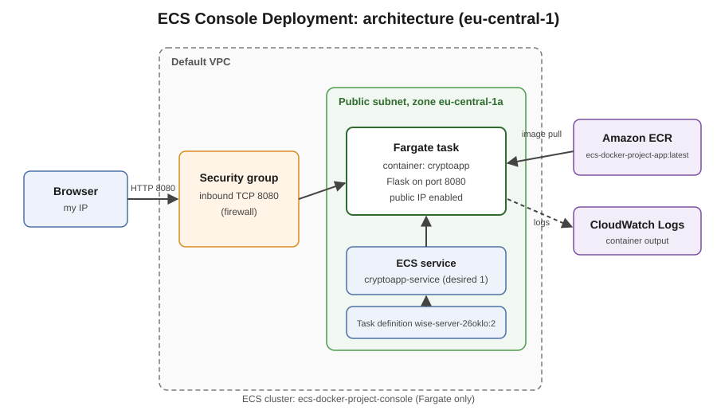
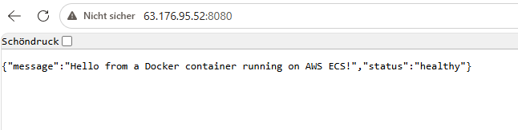

# The Complete Guide to This Project

### (Written so anyone, even with zero background, can understand it)

This is a follow-up to the fourth project in this portfolio series ([ecs-docker-project](https://github.com/Ralso11/ecs-docker-project)). That project deployed a container to AWS with Terraform and a pipeline. This one deploys **the same container by hand in the AWS Console**, which exposes every component that automation normally hides — and, as it turned out, a few things that can go wrong.

It assumes you know what Docker, an image, and ECR are (explained in the fourth project's guide).

---

## Part 1 — Why do this by hand when Terraform exists?

Infrastructure code is the right way to run things in real life: repeatable, reviewable, no forgotten clicks. But it has a downside for learning: when `terraform apply` succeeds, you never see *what* it did or *why* each piece exists. When it fails, the error can be hard to interpret if you have never seen the pieces individually.

Doing it manually once means:

- you see each AWS object (cluster, task definition, service, security group) as a separate thing with its own settings,
- you hit and fix the same problems that Terraform would otherwise hide, and
- the next time you write the Terraform, you know exactly what each block corresponds to.

## Part 2 — The pieces, and how they connect

```
Docker image in ECR  (already built and pushed in the previous project)
        |
        |  referenced by
        v
  Task Definition  (blueprint: image, CPU/RAM, container port, logging)
        |
        |  used by
        v
     Service  (keeps 1 copy running, restarts it if it fails)
        |
        |  starts
        v
      Task  (the running container, with a network interface and a public IP)
        |
        |  protected by
        v
  Security Group  (firewall: which ports may be reached from where)
        |
        v
  You, in a browser:  http://<public-ip>:8080
```

All of this lives inside an **ECS cluster**, which on Fargate is only an organizational folder (there are no servers to manage in it).

The diagram in the [README](README.md#architecture) shows the same thing as a picture, including the VPC, subnet, ECR, and CloudWatch Logs:



## Part 3 — Step-by-step: what was actually done

### Step 1: Create the cluster

**ECS → Clusters → Create cluster**

| Field | Value | Why |
|---|---|---|
| Cluster name | `ecs-docker-project-console` | Follows the naming of the other projects; also separates it from the Terraform cluster. The name **cannot be changed later**. |
| Infrastructure | AWS Fargate (serverless) only | No EC2 servers to manage. |
| Container Insights | Off | Extra CloudWatch metrics cost money and are not needed for a demo. |
| Namespace, encryption, tags | defaults | Namespace only matters for Service Connect. |

An empty Fargate cluster costs nothing.

### Step 2: Create the task definition

**ECS → Task definitions → Create new task definition**

| Field | Value | Why |
|---|---|---|
| Launch type | AWS Fargate | Same as the cluster. |
| OS / architecture | Linux / X86_64 | Image was built on a Windows PC (x86). An image built on an ARM machine would need ARM64. |
| CPU / memory | 1 vCPU / 3 GiB (console default) | More than a small Flask app needs; 0.25 vCPU / 0.5 GB would also be enough. |
| Task execution role | `ecsTaskExecutionRole` | The identity **ECS** uses to pull the image and write logs. It is not the app's own identity. |
| Container name | `cryptoapp` | Just a label, used in logs. |
| Image URI | `<account-id>.dkr.ecr.eu-central-1.amazonaws.com/ecs-docker-project-app:latest` | Copied from the ECR console. Always include the tag. |
| Container port | **8080** | Must match the port the app listens on (see Part 4, Problem 1). |

> **Naming note:** the console generated the family name `wise-server-26oklo`. The text field the tutorial calls "task definition name" was actually the *container* name. Family names cannot be renamed.

### Step 3: Create the service

**Cluster → Services → Create**

| Field | Value | Why |
|---|---|---|
| Task definition | the family, latest revision | Revision `:2` after the fix. |
| Service name | `cryptoapp-service` | |
| Scheduling | Replica, desired tasks = 1 | Daemon is only for EC2 clusters. |
| VPC | default VPC | |
| Subnets | **one subnet, in zone 1a** | See Part 4, Problem 2. The console preselects all subnets, which turned out to be a trap. |
| Public IP | **On** | Without it the task can neither pull from ECR over the internet nor be reached from a browser. |
| Security group | default group with an extra inbound rule: Custom TCP 8080 | See Part 4. |

### Step 4: Test

Open the task, copy its **Public IP**, visit `http://<public-ip>:8080`. Expected:

```json
{"message":"Hello from a Docker container running on AWS ECS!","status":"healthy"}
```

Not a login page — the tutorial's application is a different one. For this app, a small JSON response *is* success.



## Part 4 — What went wrong, and why

### Problem 1: The task was running, but the page did not load

**Symptom:** the task showed `Running`, but `http://<ip>:5000` did nothing.

**Cause:** The first task definition revision mapped container ports **80 and 5000**, copied from the tutorial's example. The Flask app from the fourth project listens on **8080**. A port mapping only tells AWS which port to expose; it does not change which port the app uses. Nothing was listening on 80 or 5000, so nothing answered.

**How it was found:** the task's **Logs** tab showed the app's own start-up lines:

```
* Running on all addresses (0.0.0.0)
* Running on http://127.0.0.1:8080
* Running on http://172.31.27.191:8080
```

**Fix:**

1. Task definitions → family → select revision 1 → *Create new revision*.
2. Remove the 80 and 5000 mappings, add a single one: container port 8080, TCP, HTTP.
3. Service → *Update* → pick the new revision → tick **Force new deployment**.
4. Security group → inbound rule: Custom TCP, port 8080.

**Lesson:** the container port must come from the app (its code, Dockerfile `EXPOSE`, or its log output) — not from a tutorial.

### Problem 2: New tasks kept stopping with an ECR timeout

**Symptom:** after the update, every new task ended up `Stopped` within seconds with this message:

```
ResourceInitializationError: unable to pull secrets or registry auth:
The task cannot pull registry auth from Amazon ECR: There is a connection
issue between the task and Amazon ECR. ... dial tcp ...:443: i/o timeout
```

After three failed tasks the service's **deployment circuit breaker** triggered and **rolled back** to revision 1. That is why the service showed `Rollback successful` even though the real problem was elsewhere.

**Clue:** the **Availability zone** column. The original (working) task ran in **eu-central-1a**. Every failed task ran in **1b** or **1c**.

**What it means:** to start a Fargate task, ECS must first fetch an authorization token from ECR over the network. In some subnets that connection timed out. The exact reason (for example, a route table without a working path to the internet) was **not** inspected; the pragmatic fix was to stop using those subnets.

**Fix:** Service → Update → Networking → remove every subnet except the one in zone 1a → force new deployment. The new task came up in 1a and reached `Running`.

**Lesson:** when a service is given several subnets, tasks are spread across zones. If one zone's network is wrong, failures look random ("sometimes works, sometimes doesn't"). In the Terraform project there was exactly one subnet, so this never appeared.

### Problem 3: Expecting the tutorial's result

The tutorial ends with a login page, because it deploys a different application. Comparing the result with the *right* expectation (what does **my** image return?) would have saved some confusion.

## Part 5 — How to read ECS when something fails

| Where | What it tells you |
|---|---|
| **Task page → "Stopped" message** | The reason a task died (image pull problems, role problems, out of memory). Always the first place to look for a task that will not stay up. |
| **Task page → Logs tab** | What the application itself printed. Shows the real listening port, crashes, stack traces. |
| **Service → Events tab** | A timeline: "has started 1 tasks", "was unable to place a task. Reason: ...", "rolling back". |
| **Service → Deployments tab** | Whether a rollout is in progress, succeeded, or was rolled back by the circuit breaker. |
| **Task list → Availability zone / Task definition columns** | Patterns: always the same zone failing, or only a certain revision failing. |

A reusable decision path is in the [README](README.md#debugging-path-reusable).

## Part 6 — The same thing via the AWS CLI (reference)

*These commands mirror the console steps and are included for reference; they were not run in this session.* Replace the `<...>` placeholders.

```bash
# 1. Cluster (Fargate needs no extra capacity setup)
aws ecs create-cluster --cluster-name ecs-docker-project-console --region eu-central-1

# 2. Task definition (see task-definition.json in this repo)
aws ecs register-task-definition --cli-input-json file://task-definition.json --region eu-central-1

# 3. Service, with ONE known-good subnet and a public IP
aws ecs create-service \
  --cluster ecs-docker-project-console \
  --service-name cryptoapp-service \
  --task-definition cryptoapp-task \
  --desired-count 1 \
  --launch-type FARGATE \
  --network-configuration "awsvpcConfiguration={subnets=[<SUBNET_ID>],securityGroups=[<SG_ID>],assignPublicIp=ENABLED}" \
  --region eu-central-1

# 4. Open the app port in the security group
aws ec2 authorize-security-group-ingress --group-id <SG_ID> \
  --protocol tcp --port 8080 --cidr <YOUR_IP>/32 --region eu-central-1

# After changing the task definition: roll out the new revision
aws ecs update-service --cluster ecs-docker-project-console --service cryptoapp-service \
  --task-definition cryptoapp-task --force-new-deployment --region eu-central-1
```

Note: `awslogs-create-group` in `task-definition.json` requires the execution role to be allowed to create log groups; if the task fails to start because of that, create the log group `/ecs/cryptoapp-task` manually first.

## Part 7 — Cleanup and cost

Fargate bills for reserved CPU and memory while a task runs, and this AWS account is on the credit-based free plan, so nothing is left running.

1. **Delete the service** (Cluster → Services → `cryptoapp-service` → Delete, tick *Force delete*). This also stops the task.
2. **Delete the cluster** (optional, an empty Fargate cluster is free but clutters the account).
3. **Remove or restrict the inbound rule for port 8080** in the security group.
4. **Keep the ECR repository** — it is small and is used by the Terraform project.

## Part 8 — Terraform vs. console: what maps to what

| In the console | In `ecs-docker-project`'s Terraform |
|---|---|
| Create cluster | `aws_ecs_cluster` |
| Task definition | `aws_ecs_task_definition` |
| Create service | `aws_ecs_service` |
| Task execution role | `aws_iam_role` for ECS |
| Logging configuration | `aws_cloudwatch_log_group` + `logConfiguration` |
| Security group rule | `aws_security_group` ingress block |
| New revision + force new deployment | pipeline step `aws ecs update-service --force-new-deployment` |

## Part 9 — Glossary (new items vs. previous projects)

| Term | Plain-language meaning |
|---|---|
| Task definition revision | A numbered version of the blueprint; any change creates a new one (`:1`, `:2`, ...). Old revisions are kept. |
| Task | One running copy of the container with its own network interface and IP. |
| Force new deployment | Tells the service to replace its tasks even if nothing in the configuration changed, so the newest revision/image is picked up. |
| Deployment circuit breaker | A safety feature: after repeated task failures, it stops the rollout and rolls back to the last working version. |
| Availability Zone (AZ) | One physical data-center location inside a region (`eu-central-1a`, `1b`, `1c`). Subnets live in exactly one. |
| Public IP (on the task) | Needed for pulling the image over the internet and for being reachable from a browser. Changes with every new task. |
| Container port vs. host port | The port the app listens on inside the container vs. the port exposed outside. On Fargate (`awsvpc`) they are the same. |
| Stopped reason | The message on a stopped task's page explaining why it died. |

## Part 10 — How to explain this project in an interview

> "After deploying a containerized Flask app to ECS with Terraform and a pipeline, I redeployed the same image manually through the AWS Console to understand every component the automation hides. I hit two real problems. First, the app was running but unreachable, because my port mapping didn't match the port the app actually listened on — I found that from the container logs and fixed it with a new task definition revision. Second, new tasks kept failing with an ECR connection timeout; by comparing availability zones I saw that only the zone the original task ran in worked, so I restricted the service to that subnet. The circuit breaker had also rolled the service back automatically, which I had to recognize as a symptom rather than the cause. The main takeaway is the debugging order: stopped reason, logs, networking — and not trusting a tutorial's values for my own application."

That story shows hands-on ECS knowledge, log-driven debugging, and an honest understanding of what was and wasn't verified.

---

*This document, together with the README, covers everything needed to understand, explain, and rebuild this project.*
