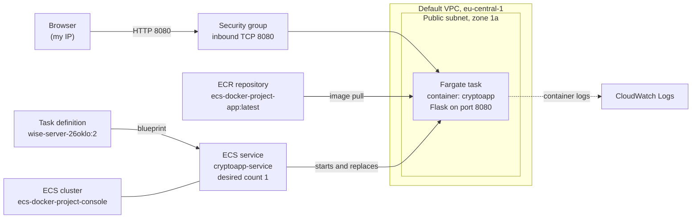
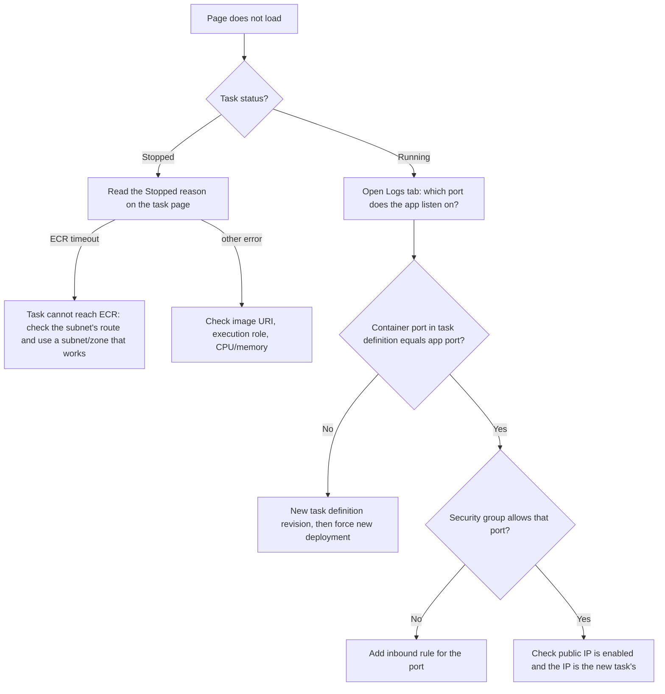

# ECS Console Deployment

📖 Want the full, beginner-friendly walkthrough of every click, error, and decision? See [PROJECT_GUIDE.md](PROJECT_GUIDE.md).

## What is this project, in one sentence?

The same Dockerized Flask app from [ecs-docker-project](https://github.com/Ralso11/ecs-docker-project), deployed to AWS ECS Fargate **by hand through the AWS Console** (no Terraform, no pipeline) — to understand what the infrastructure code actually automates, and to debug the things that go wrong when you wire it up manually.

## Why this project exists

The fourth project deployed a container to ECS entirely through Terraform and GitHub Actions. That works, but it hides the individual moving parts: cluster, task definition, service, networking, security group. This project follows the KodeKloud tutorial *"How to Deploy a Docker Image on AWS ECS Cluster"* and rebuilds the same result click by click, using the existing image in ECR.

It turned out to be more valuable than expected, because two real problems showed up (a wrong container port and an ECR connection timeout in some availability zones). Diagnosing them from logs and events is exactly the kind of troubleshooting that Terraform runs tend to hide.

## Architecture



- **ECS cluster** — a logical grouping; with Fargate there is no server capacity to manage inside it.
- **Task definition** — the blueprint: which image, how much CPU/memory, which container port, where logs go. Every change creates a new numbered *revision* (`:1`, `:2`, ...).
- **Service** — keeps the desired number of tasks running and replaces failed ones.
- **Task** — one running copy of the container (the thing that actually gets a public IP).
- **ECR** — the private image registry the task pulls from at startup.
- **Security group** — the firewall in front of the task; without an inbound rule for the app's port, the page times out even though the task is healthy.

## Configuration used

| Setting | Value |
|---|---|
| Region | eu-central-1 (Frankfurt) |
| Cluster | `ecs-docker-project-console`, AWS Fargate only |
| Task definition | family `wise-server-26oklo` (auto-generated), container `cryptoapp`, 1 vCPU / 3 GiB |
| Image | `ecs-docker-project-app:latest` from the existing ECR repository |
| Container port | **8080** (revision `:2`) |
| Execution role | `ecsTaskExecutionRole` |
| Service | `cryptoapp-service`, 1 desired task, Fargate |
| Networking | default VPC, public subnet in zone 1a, public IP enabled, default security group + inbound TCP 8080 |

Result when it worked:

```json
{"message":"Hello from a Docker container running on AWS ECS!","status":"healthy"}
```

## Problems & fixes — quick reference

| Problem | Why it happened | How it was fixed |
|---|---|---|
| Page did not load although the task was `Running` | Task definition revision `:1` mapped ports 80 and 5000 (copied from the tutorial), but this Flask app listens on **8080**. The **Logs** tab showed `Running on http://0.0.0.0:8080` | Created revision `:2` with a single mapping for 8080, forced a new deployment, opened TCP 8080 in the security group |
| New tasks stopped with `ResourceInitializationError ... ECR ... i/o timeout`; the circuit breaker rolled the service back | The service was spread across several subnets. Tasks that landed in zones **1b and 1c** could not reach the ECR API; the first task in **1a** had pulled the image fine | Updated the service to use only the subnet in zone 1a, with a forced new deployment. The exact cause in 1b/1c (route table or similar) was not inspected |
| Expected a login page like in the tutorial | The tutorial deploys a different application; this image just returns a small JSON response | Nothing to fix — a JSON `"status":"healthy"` response *is* the correct result |
| Task definition family is `wise-server-26oklo`, not `cryptoapp` | The console auto-generated the family name; `cryptoapp` was only the container name | Harmless. Family names cannot be renamed; create a new task definition if a clean name matters |

## Debugging path (reusable)



## Terraform project vs. this project

| Concern | [ecs-docker-project](https://github.com/Ralso11/ecs-docker-project) (Terraform) | This project (console) |
|---|---|---|
| Networking | Own VPC with a single public subnet | Default VPC, one subnet per zone |
| Image | Built and pushed by the pipeline | Reused the image already in ECR |
| Logging | Log group with 7-day retention, defined in code | Console default `awslogs` configuration |
| Deployment | Pipeline: apply, build, push, force redeploy | Manual: new revision, update service, force new deployment |
| Repeatability | One click / one push | Manual clicks, easy to get slightly wrong |
| Learning value | Automation, CI/CD | Seeing each component and its failure modes |

A useful takeaway: with Terraform's single subnet the zone problem never appeared. In the console, accepting every preselected subnet meant tasks were scattered across zones, and one bad zone caused intermittent failures.

## Cost management

Fargate bills for reserved CPU/memory while a task runs, and this AWS account uses the credit-based free plan. After verifying the app, the service is deleted (or scaled to 0), the cluster is removed, and the extra security group rule is deleted. The ECR repository stays — the image is small and the Terraform project uses it.

## How to reproduce this project

1. Make sure an image exists in ECR (see the Terraform project, or `View push commands` in the ECR console).
2. **ECS → Clusters → Create cluster**: Fargate only, leave Container Insights off.
3. **Task definitions → Create new**: Fargate, execution role, container image URI with the `:latest` tag, **container port = the port your app really listens on** (check the Dockerfile or the app's start-up log).
4. **Cluster → Create service**: pick the task definition, desired tasks 1, default VPC, **choose one known-good subnet**, public IP on, security group with an inbound rule for the app port.
5. Open the task, copy the public IP, test `http://<ip>:<port>`.
6. If something fails, follow the debugging path above (Stopped reason, then Logs, then security group).
7. Delete the service and cluster when finished.

A CLI/JSON version of steps 2–4 is in [PROJECT_GUIDE.md](PROJECT_GUIDE.md#part-6--the-same-thing-via-the-aws-cli-reference) and [`task-definition.json`](task-definition.json).

## What's next (possible future additions)

- Put an Application Load Balancer in front of the service, so the URL no longer changes with every new task.
- Add a container health check so ECS can detect an unhealthy app and not only a crashed one.
- Create a task definition with a clean family name, and tag images with a commit SHA instead of only `:latest`.
